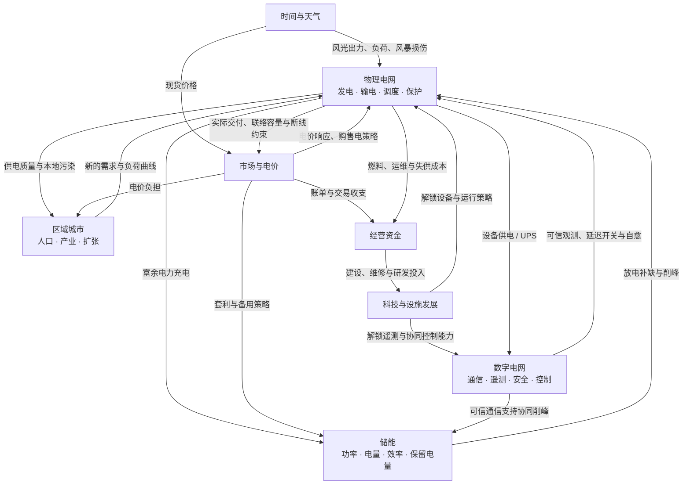

# 潮汐电网：实现与玩法

当前版本是基于《智能电网游戏报告》实现的单人可玩切片：一张青屿湾地图、建造和接线、昼夜供需、风光与储能、线路过载和故障、两支维修队、经营收支、两级数字化研究及四项通关委托。市场模块已实现零售电价、现货购售电、储能策略、12 小时固定功率锁价合约和日结账本；数字模块已实现独立通信图、UPS、可信观测、延迟控制、现场队和抽象网络事件。现已加入六代、24 项研究、16 种新增设施、可选历史开局以及 48 × 48 八城动态区域；多人模式仍未实现。详细新玩法见 [代际电网与区域沙盘](GAMEPLAY.md)。

新增经营扩展将预测、复盘、资产寿命、轻量输配电、用户侧光储充电、微电网与长期投资接入同一仿真。研究区域负荷规划后分别投运，用户侧协调还需SCADA；旧档迁移时默认未投运，历史战役继续使用情景规则。玩法入口与工程简化边界见 [经营扩展指南](EXPANSION.md)。

## 核心循环

历史教学战役另由 `campaign.gd` 的运行状态、`campaign_catalog.gd` 的十五章任务资料与 `scenario_map.gd` 的地图资料组成。每关建立独立真实仿真局面，能力规则同时约束模型入口与界面。当前阶段由模型状态和实际操作回执推进；持续目标只在结算后累积，事件按阶段幂等触发。章节解锁profile与当前运行存档分开，地图尺寸不再要求启用八城沙盘。详见 [战役指南](CAMPAIGN.md)。

观察需求与供电 → 建造设施 → 连接电网 → 调整燃气出力、储能与交易策略 → 检查线路负载和经营账本 → 增容或建立备用路径 → 处理风暴与检修 → 研究数字化 → 完成委托并扩建。

地图采用正交相机呈现 2.5D 斜视角。建筑、风机、光伏板、变电设施、树木、海岸和车辆均有原创低多边形模型；建造菜单图标由同一批模型渲染，保存在 `assets/icons/`。昼夜驱动环境光和已供电建筑的灯光，风暴驱动雨幕。模型用于表达仿真结果；风机动画、镜头和图层不会决定实际发电或故障。

主 HUD 使用共享主题与独立组件构建：底边常驻关键状态，建设托盘、任务、日志和统计按需展开，检查器只在选中对象时显示。三个经营中心复用同一规划窗口外壳；界面状态不写入仿真存档。

## 系统协作关系

图中箭头表示玩法上的影响。`GridSimulation` 统一管理时间、共享状态与结算；调度、储能、天气、经济、任务和存档主要在内核中实现，市场、数字电网、代际科技、区域城市和 DC 求解器由内核持有并协调。



主场景把 HUD、地图和三个经营中心的玩家操作转成仿真命令，再将结果同步到界面与 3D 世界。任务系统根据实际供电、清洁能源、研发和恢复情况发放奖励，长期目标鼓励持续运营；手动与自动存档保存各模块的完整快照。只有时间推进会持续结算电量、运营现金、研发和城市发展，读取信息与刷新界面没有这些副作用。

## 模块职责与报告映射

| 实现位置 | 负责内容 | 支持的玩法 |
| --- | --- | --- |
| `scripts/sim/grid_sim.gd` | 稳定整数 ID 的建筑/支路数据、连接关系、开关与故障 | 建造、拆除、环网、孤岛、断路器操作 |
| `scripts/sim/grid_dispatch.gd` 与 DC 求解器 | 逐机组成本排序、辅机保障、来源核算、每岛供需与线路潮流 | 混合电源经营、光储协同、备用路径、线路增容 |
| 同上：时间、天气、储能 | 住宅晚高峰、工厂日间负荷、风光变化、MWh 与充放电 | 电源组合、削峰和夜间供电 |
| 同上：保护和维修 | 过载积热跳闸、风暴隔离、设备健康与维修队 | 检修、抢修、恢复供电与韧性委托 |
| 同上：经济、科技、任务、存档 | 收入成本、建造资金、研究、奖励、可复现状态 | 经营取舍、成长、通关与继续运营 |
| `scripts/sim/grid_evolution.gd` | 代际目录、前置与研发、启停爬坡、配套名额、运行策略与费用 | 核能消纳、配套选型、保护裕度、储能协同、历史解锁 |
| `scripts/sim/region_world.gd` | 有界城市人口、服务反馈、产业压力与扩张 | 长距离供电、不同负荷曲线、增长与衰退 |
| `scripts/ui/planning_panel.gd`、`region_map.gd` | 科技目录、明确提交的细节控制、区域概览与持续目标 | 暂停规划、推进时间、定位城市与比较策略 |
| `scripts/sim/power_market.gd` | 现货报价、零售电价、用户满意度、固定合约与账本 | 购售电、电价制定、储能套利、锁价与经营反馈 |
| `scripts/sim/digital_grid.gd` | 独立通信图、UPS、信任状态、观测、命令队列与抽象网络事件 | 遥测、远程/现场控制、冗余路径、隔离与修补 |
| `scripts/sim/grid_planning.gd` | 隔离副本预测、假设范围、停电过程与统一现金记录 | 提前启机、方案比较、单故障检查、经营复盘 |
| `scripts/sim/asset_lifecycle.gd` | 健康与年龄风险、储能SOH、备件、出行及优先检修队列 | 预防维护、大修与更换、套利寿命成本 |
| `scripts/sim/grid_engineering.gd` | 双电压等级、变电容量、简化压降、实际损耗与分段保护 | 长距离输电、就地资源、供电质量与保护选择 |
| `scripts/sim/customer_energy.gd` | 净计量街区、用户授权、光储充电、移峰回补、微电网切换 | 用户侧能源协调、反送、柔性合同、分阶段恢复 |
| `scripts/sim/strategic_economy.gd` | 工期、场地预留、贷款、日前实物购电、备用、出清与政策灾害 | 提前投资、履约风险、长期目标与韧性经营 |
| `scripts/main.gd` | 输入、地图选择、相机、HUD、检查器、模型同步 | 建造操作、因果信息、调度控制与反馈 |
| `scripts/ui/power_chart.gd` | 供需曲线和电气拓扑示意 | 观察趋势与理解网络连接 |
| `scripts/ui/market_panel.gd`、`market_chart.gd` | 市场草案、命令提交、价格参考曲线与账本显示 | 暂停规划、明确应用、推进一小时检验结算 |
| `scripts/ui/digital_panel.gd`、`digital_map.gd` | 可见通信状态、独立拓扑、操作回执、已检测告警 | 暂停规划、布线、演练与推进十五分钟核实恢复 |
| `scripts/art/`、`assets/models/` | 模型工厂、地形工厂及可复用场景 | 统一视觉、设施辨识与独立资产编辑 |

仿真对象继承 `RefCounted`，仍运行于 Godot/GDScript，但不引用相机、材质、场景树或 UI。界面向它提交 `build`、`connect_buildings`、`set_dispatch`、`toggle_line`、`repair_line` 等命令，再读取 `buildings`、`lines`、`totals`、日志和任务状态。无头测试可以直接创建相同仿真对象。

## 电力计算与取舍

每次仿真推进会划分为最长 0.05 游戏小时的小步，并在价格时段或合约边界处分割。开关合闸且无故障的支路组成电气图，检修停机的变电站会隔离相连支路；连通分量分别调度。热机最低承诺出力先参与消纳，然后使用风光与零燃料水电、已付费合约，再按逐机组真实边际燃料费比较本地出力和现货。保供模式先使用本地资源，经济交易可以用更便宜的进口替代高成本出力；外售也比较对应机组的增量成本，已发生燃料费用的最低承诺能源可用于储能或外售。

运行中的核电和聚变需要实际供给分配到的冷却设施与学院，厂用电优先于医院及其他用户；不足时停止可交付出力并安全停机，恢复后重新完成有电源支持的启动。最低稳定负荷以额定容量为基准，非零出力设定不能低于对应下限；启动、降载期间允许有界爬坡，无法消纳的承诺出力仍支付燃料和排放成本。

联络站是参与 DC 潮流的真实节点，进口与外售改变本地线路负载；断线会阻止跨岛交付。报价与预测读取不推进电量或资金，只有实际时间推进才结算。原市场保留现货和12小时固定功率合约；投运长期经营后增加逐小时实物购电承诺、实际偏差5%履约费和备用，并可选择聚合外部供应的统一价格出清。没有完整订单簿、节点电价或真实市场接入。原电价曲线仍是当前天气下的参考；发展工作台另提供遵守观测边界的24小时负荷、风光、储能与运行方案推演。

线路使用简化 DC 有功潮流：以端点格距近似电抗，形成加权图拉普拉斯矩阵，固定一个参考节点，通过带主元选择的高斯消元求各节点相角，再计算支路功率。添加环网会重新分流；断开线路会改变其他路线的负载。线路超过容量后积热，持续过载会跳闸，因此备用线或增容会改变故障后果。

未投运输配电管理时保留固定电压、无损耗的有功近似。投运后增加配电/输电两级、变电站独立容量、简化有功压降和I²R损耗：先做不提交能量的调度确定真实出力节点，以供电路径和初步DC通过功率限制交付，再迭代由实际电源支付损耗。能量核算显式扣除线路损耗，查询不提交储能或用户侧能量。

这些规则仍是经营近似，没有完整AC、无功潮流、三相不平衡或精细保护整定，也不是带网络约束的最优潮流调度。线路可短时过载，持续超限由本地保护处理。基础天气和需求仍采用确定性曲线，另有可配置区域热浪、洪水与燃料中断；预测区间是情景假设而非统计置信承诺。

HUD可靠率仍为当前已供需求占比，累计可靠率为累计已供MWh/累计需求MWh。新增停电复盘记录聚合负荷节点的起止、失供电量、关键负荷和恢复曲线，不等同于按真实客户数计算的长期SAIDI/SAIFI。街区用户侧先自发自用再净计量，公共电网账单只结算净用电。

自然风暴首次在第 1 天 14:00（开局后 6 游戏小时）到来，此后每 30 游戏小时一轮，提前 1 小时发送预警；也可由玩家手动启动演练。风暴持续约 2.5 游戏小时，会损伤并隔离线路、压低风光出力，预报提示玩家提前检查备用路径与储能。风暴离开后，受损线路仍需维修才能恢复。

## MW 与 MWh

**MW** 表示当前功率，决定“此刻能供多少”；**MWh** 表示储存或累计使用的能量。初级电池为 **10 MW / 30 MWh**，初始半电量，充电和放电效率各为 94%。其最大放电功率受 10 MW 限制，持续时间受当前 MWh 限制。电池不会凭空产生电力，也不会在同一步同时充放电。

## 开局与四项委托

开局资金为 ¥180,000，地图已有十座设施；东部工业园区尚未接网。

1. **点亮海湾**：按 `2` 切换接线，先点中央变电站，再点东部工业园区。全城供电达到 98% 即获 ¥12,000。
2. **绿色转型**：在空地建设并连接光伏或风电，使两类设施总数至少三座、可再生供电占比达到 35%，获得 ¥18,000。建造后检查线路，夜间光伏会停机。
3. **可观测的城市**：通过委托详情中的研究入口完成两级研究，获得 ¥20,000。
4. **风暴之后**：启动一次风暴演练，点击红色线路派抢修队，修复全部故障并恢复至少 98% 供电，获得 ¥25,000。最多两项检修同时作业；线路维修约 36 游戏分钟，设施检修约 39 分钟。

四项完成后显示通关面板，可继续运营或重新开始。任务奖励只发放一次；建造与完成任务在同一操作中发生时，现金变化会同时包含支出和奖励。

## 建造与经营参数

| 设施 | 基础价格 | 基础能力 |
| --- | ---: | --- |
| 燃气电站 | ¥38,000 | 24 MW，可设置出力上限 |
| 光伏电站 | ¥18,000 | 12 MW，随日照和云层变化 |
| 风力机组 | ¥24,000 | 14 MW，随风况变化 |
| 储能电站 | ¥22,000 | 10 MW / 30 MWh |
| 变电站 | ¥10,000 | 电气连接节点 |
| 住宅街区 | ¥8,000 | 基础负荷 4.5 MW，晚间增长 |
| 工业园区 | ¥14,000 | 基础负荷 11 MW，日夜变化 |
| 智能终端 | ¥7,000 | 相邻支路本地遥测 |
| 市场联络站 | ¥32,000 | 14 MW 双向外网交换节点 |
| 调度中心 | ¥22,000 | 冗余通信调度根节点 |
| 通信中继 | ¥12,000 | 无线单跳距离可达 10 格 |
| 安全中心 | ¥18,000 | 可信接网后改善检测与恢复 |
| 社区医院 | ¥12,000 | 6 MW 关键负荷，初始地图提供；目录/API 可建造 |

新线路费用为 ¥1,600 加端点格距 × ¥300，基础容量 24 MW。线路增容费用为当前等级 × ¥4,500，容量变为原来的 1.6 倍；最高三级。设施升级费用为基础价格 × 0.65 × 当前等级，并按类型产生实际收益：电源、储能和联络站增加能力，学院增加岗位，冷却设施增加配额且不增加辅机需求。暂无能力升级的变电站、数字网关和调相机拒绝等级购买，可改造相连线路或通信、安全能力。拆除回收玩家实际投入的 35%，市政免费资产本体不产生退款，玩家支付的升级投资仍可部分回收。

经营按已供电量收取电费，扣除燃气发电成本、设施和线路运维费，以及每 MWh ¥60 的失供补偿。医疗供电零售价最高 ¥145/MWh，保持关键负荷需求；住宅和工业会受到电价弹性与长期满意度留存影响。单位与价格为游戏平衡参数。需求随天数缓慢增长，燃气产生碳排放；HUD 显示每小时净收益，帮助判断扩建是否可持续。

## 数字化如何改变能力

| 研究 | 费用 | 可用能力 |
| --- | ---: | --- |
| L1 馈线遥测 | ¥16,000 | 允许具备可信通信的网关回传线路测量；未研究时局部智能终端也需真实路径与采样 |
| L2 自愈控制 | ¥32,000 | 通过可信低时延通信操作健康备用线，并向可控负荷提供需求响应 |

自愈控制会比较恢复效果和负载，拒绝无效或不安全的合闸；不会自动合上故障线，也不会直接重合因持续过载跳闸的线路。未投运用户侧协调时，需求响应沿用¥1,000、两游戏小时、可控普通负荷降低20%的教学模型，医院不参与。投运后原入口改为签约街区移峰，按实际参与电量补偿并在结束后回补；扩展页可分别选择削减或移峰、参与率和期限。

通信图与电力图独立。网关失电有两小时 UPS，停机检修会直接停用网关；光纤和无线有各自范围、时延、成本与风暴风险。研究不等于全知，设施信息通过 `facility_observation`、线路信息通过 `line_observation` 返回未知、可信、过时、可疑或现场核实状态。地图故障标记、能流动画和检查器遵守同一观测边界，未检测事件也不会直接暴露目标。

远程控制要求研究、足够新鲜的遥测、两端可信低时延路径，先排队再在到达时验证；现场开关和巡检不依赖通信，但消耗时间、资金和有限队伍。DoS、遥测欺骗、非法控制是离线抽象事件，由策略、防护等级和安全中心影响检测及阻挡。隔离与补丁有恢复代价；具体流程见 [数字电网指南](DIGITAL.md)。没有完整通信协议、数据包或真实外部攻击功能。

## 存档与验证

JSON存档目前使用 `schema_version = 9`，保存建筑、支路、资金、时间、任务、研究、天气与风暴日程、维修、累计指标、随机种子和状态，以及市场、通信、观测、在途命令、热机、城市、独立战役和经营路线。旧schema1—8仍可读取，缺失模块按版本迁移；读取时检查结构、引用与计时，将JSON数字恢复为整数ID并重算派生潮流，无效存档不替换当前游戏。界面根据恢复的数据重建模型，避免相同ID在不同存档中保留旧外观。

schema 5 增加已投运网关与显式角色、设施观测与在途设置、资产投资和退款基数、城市拆迁安置需求、储能可再生来源电量。旧档来源未知的储能按非可再生处理；旧区域资产按已知市政生成规则迁移，付费升级保留投资。旧版本不接受自称未来字段制造的退款或清洁电量，所有新格式在替换当前游戏前完成校验。

schema 6增加独立战役快照，保存章节、步骤、持续计时、已触发事件、操作结果与目标引用。旧档默认不处于战役；情景城市支持一至八城，旧八城沙盘保持原初始化。无效章节、引用、计时或运行数据在替换当前仿真前拒绝。

schema8增加预测复盘与统一现金记录、资产风险和检修队列、输配电配置、用户侧能量与充电/移峰义务、微电网阶段与切换、工程融资、日前承诺、备用、政策灾害。旧档的新体系默认未投运，现金以迁移时余额作为期初；不能据此重建旧局未保存的历史明细。

schema9增加独立可靠性窗口、累计纳入负荷点、进行中与已恢复事件、CMI／ENS与归档汇总，以及最多96条趋势。旧schema1—8从载入时刻开启新窗口，不补造历史。校验包括时间、物理累计上界、事件与归档守恒、负荷身份引用；部门视角和信息深度不进入仿真快照。详见[职业视角指南](DEPARTMENTS.md)。

手动文件为 `user://tidal_grid_save.json`，自动文件为 `user://autosave.json`，两者独立。`user://` 的实际位置由 Godot 和操作系统决定。集成测试使用隔离的 `user://test_*` 存档，完成后删除。

```sh
/Applications/Godot.app/Contents/MacOS/Godot --headless --path . -s tests/test_sim.gd --log-file /tmp/tidal-sim-test.log
/Applications/Godot.app/Contents/MacOS/Godot --headless --path . -s tests/test_game.gd --log-file /tmp/tidal-game-test.log
/Applications/Godot.app/Contents/MacOS/Godot --headless --path . -s tests/test_market.gd --log-file /tmp/tidal-market-test.log
/Applications/Godot.app/Contents/MacOS/Godot --headless --path . -s tests/test_market_game.gd --log-file /tmp/tidal-market-game-test.log
/Applications/Godot.app/Contents/MacOS/Godot --headless --path . -s tests/test_digital.gd --log-file /tmp/tidal-digital-test.log
/Applications/Godot.app/Contents/MacOS/Godot --headless --path . -s tests/test_digital_game.gd --log-file /tmp/tidal-digital-game-test.log
```

仿真验证关注战略后果：节点功率守恒、环网分流、开关后潮流转移、储能守恒、过载保护、维修恢复、医院优先、自愈开关、确定性和存档。集成验证通过真实场景的按钮回调与地图输入路径检查建造、任务、检查器、维修、科技、需求响应、存读档、暂停、昼夜/雨幕和通关后的继续与重开。

常规启动可导入 `project.godot` 后按 F5，或在 macOS 双击 `run_game.command`。建筑、海湾与游戏截图的预览路径见根目录 `README.md`。

后续可在现有命令与快照边界上扩展完整订单簿、节点电价、更细数字协议、更大规模跨区模型和多人服务端，或替换更精细的潮流求解器。当前统一出清、输配电和微电网保持聚合经营模型；没有完成工程AC数值对照或扩展规则下最大规模长期性能验证。
